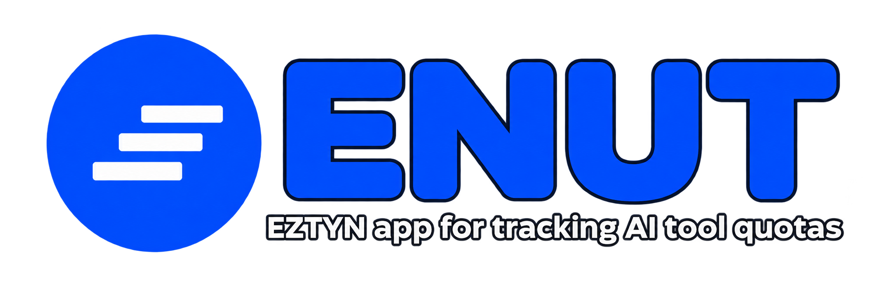
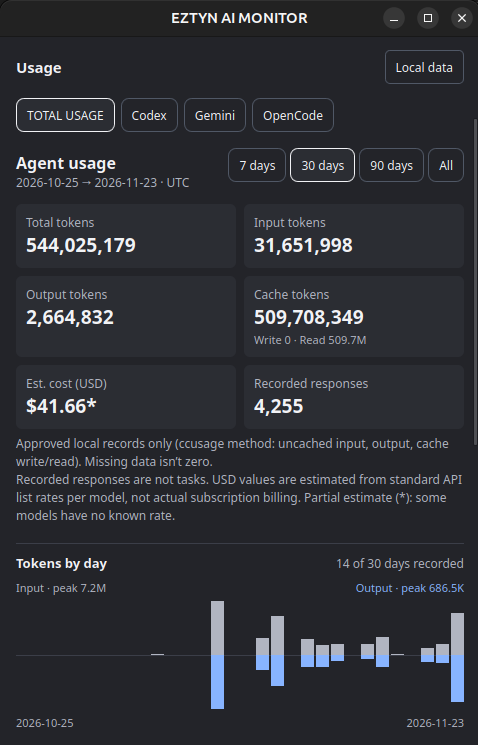

<h1 align="center">
    <a href="https://deztyn.com">
        <picture>
          
        </picture>
    </a>
    <br>
    <small>A desktop tray app for tracking AI tool quotas, local token usage, and estimated costs.</small>
</h1>

<div align="center">

[](LICENSE)
[](#install-and-run)
[](https://v2.tauri.app/)
[](https://www.rust-lang.org/)
[](https://nodejs.org/)
[](SECURITY.md)

</div>

## Table of Contents
- [Table of Contents](#table-of-contents)
- [Install and run](#install-and-run)
  - [Linux](#linux)
  - [Windows](#windows)
- [Screenshot](#screenshot)
- [Usage](#usage)
- [Supported integrations](#supported-integrations)
- [Privacy and billing](#privacy-and-billing)
- [Development](#development)

## Install and run
Common prerequisites for building from source: **Node.js 24+**, **npm**, and **stable Rust**.

Successful desktop installer builds copy the packages from that run into a new `artifacts/desktop-*/` folder at the repository root and print each path. Earlier builds are kept. Installer builds use a temporary Cargo output directory so they cannot export another run's packages; allow time and disk space for a fresh compilation. `npm run build` still builds only the web UI, and `npm run desktop:build -- --no-bundle` builds the executable in the normal Cargo target without exporting an installer.

### Linux

1. Install the [Tauri Linux system libraries](https://v2.tauri.app/start/prerequisites/#linux) (GTK 3, WebKitGTK 4.1, AppIndicator, librsvg).
2. Install JS dependencies from the project directory:

```sh
npm ci
```

3. Run in development mode or build a release package:

```sh
npm run desktop:dev
npm run desktop:build
```

- Executable without bundling: `src-tauri/target/release/ai-usage-monitor`
- Installers: `artifacts/desktop-*/` (`npm run desktop:build -- --bundles deb` builds only a `.deb`). Install it with `sudo apt install ./artifacts/<build-folder>/<installer>.deb` using the path printed by the build.

4. *(Optional)* Cross-compile the Windows NSIS installer from Linux (`llvm`/`lld` + `nsis`):

```sh
rustup target add x86_64-pc-windows-msvc
cargo install --locked cargo-xwin
npm run desktop:build:windows
```

- Output: `artifacts/desktop-*/EZTYN_AI_MONITOR_1.0.0_x64-setup.exe` (`.msi` bundles require building natively on Windows).

### Windows

1. Install **Microsoft C++ Build Tools** (**Desktop development with C++** and **Windows SDK**) alongside **stable Rust** (`x86_64-pc-windows-msvc`), and verify **Microsoft Edge WebView2 Runtime** is installed (preinstalled on Windows 10/11).
2. Install JS dependencies from PowerShell or Command Prompt:

```powershell
npm ci
```

3. Run in development mode or build Windows installers:

```powershell
npm run desktop:dev
npm run desktop:build
```

- Executable without bundling: `src-tauri\target\release\ai-usage-monitor.exe`
- Installers: open the `.exe` or `.msi` printed under `artifacts\desktop-*\`.

After launching, open **All tools** and select **Connect** next to any detected tool to grant monitoring permission.

## Screenshot



## Usage

| Tab | What it shows |
| --- | --- |
| **All tools** | Detected tools, connection controls, and quota rings with reset dates for supported windows. |
| **Usage** | Local token counts, model breakdowns, daily trends, and estimated USD costs. Select a model row to filter the chart, or **Local data** to find where history is stored. |
| **Context** | Reported MCP status and installed skill names for supported tools. |
| **EZ Control** | Live RAM/CPU gauges and per-agent subprocess/command usage for connected tools. |
| **Settings** | Language, theme, and display preferences. |

**All** in Usage means retained history, not lifetime usage. A missing value is not zero. Displayed numbers use up to two decimal places; rounding does not change recorded data. Recorded responses are not tasks, and estimated costs use standard API rates, not your subscription bill.

When the tray is available, closing the window hides it without stopping monitoring. Use **Open EZTYN AI MONITOR** to restore it or **Quit** to stop monitoring.

## Supported integrations

| Tool | What the app can report |
| --- | --- |
| **Codex** | Subscription quota windows and local usage from supported rollout records. API-key sign-in does not provide a ChatGPT subscription quota. |
| **Claude Code** | Recorded input and cache counters; complete token totals when supported SDK stream records are available. |
| **Gemini CLI** | Local usage from approved saved transcripts. |
| **Antigravity** (shown as **Gemini** in All tools) | Supported model-group quotas and reset dates from the Antigravity CLI. |
| **OpenCode** | Tool-reported token and model totals and supported Go/Console quota windows. Undated source totals are not added to daily usage. |
| **Hermes** | Provider quota windows and resets when available from `hermes usage --json`. |
| **Ollama / LM Studio** | Local model inventory, not token accounting. |

See the [integration notes](docs/integrations) for version requirements, session scope, and limits.

## Privacy and billing

- **Connect** grants monitoring permission for that tool. Sign-in uses the native tool when needed; installation detection alone does not grant access. See [authentication](docs/integrations/authentication.md).
- Approved usage history is stored locally in SQLite. **Revoke** removes the tool's saved monitoring permission and history from the active store without signing you out or deleting source transcripts.
- On startup, the monitor removes the old `monitor-state.json` only after it has validated and committed the SQLite import, or confirmed a valid SQLite store already exists. A failed import leaves the JSON untouched. If removal fails, the monitor reports a storage error, keeps the SQLite data, and retries at the next startup. After removal, older versions that only read JSON cannot restore your SQLite history or approvals.
- Optional OpenAI or Anthropic **API cost reporting** is separate from monitoring. It requires an organization reporting credential and shows organization-wide costs, not this computer's spend or remaining subscription credit.
- The monitor makes no inference requests.

## Development

The UI uses TypeScript and Vite; Tauri and Rust handle desktop integration. `npm run dev` opens a browser-only preview that cannot detect local tools or read account data.

```sh
npm test
npm run check
npm run build
cargo test --manifest-path src-tauri/Cargo.toml --no-default-features
```

See [UI controls](docs/ui-quota-context.md) and the [IPC contract](docs/ipc-contract.md) for technical details.
